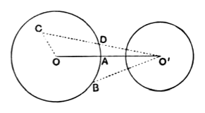
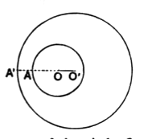

*do not meet at any other point*, Mr Taylor uses the questionable corollary. Therefore in any case his alternative procedure does not seem preferable to Euclid's.

The alternative to Eucl. III. 11—13 which finds most favour in modern continental text-books (e.g. Legendre, Baltzer, Henrici and Treutlein, Veronese, Ingrami, Enriques and Amaldi) connects the number, position and nature of the coincidences between points on two circles with the relation in which the distance between their centres stands to the length of their radii. Enriques and Amaldi, whose treatment of the different cases is typical, give the following propositions (Veronese gives them in the converse form).

1. *If the distance between the centres of two circles is greater than the sum of the radii, the two circles have no point common and are external to one another.*

Let $O, O'$ be the centres of the circles (which we will call "the circles $O, O'$"), $r, r'$ their radii respectively.

Since then $OO' > r + r'$, *a fortiori* $OO' > r$, and $O'$ is therefore exterior to the circle $O$.

Next, the circumference of the circle $O$ intersects $OO'$ in a point $A$, and since $OO' > r + r'$, $AO' > r'$, and $A$ is external to the circle $O'$.

But $O'A$ is less than any straight line, as $O'B$, drawn to the circumference of the circle $O$ [III. 8]; hence all points, as $B$, on the circumference of the circle $O$ are external to the circle $O'$.

Lastly, if $C$ be any point internal to the circle $O$, the sum of $OC, O'C$ is greater than $O'O$, and *a fortiori* greater than $r + r'$.

But $OC$ is less than $r$: therefore $O'C$ is greater than $r'$, or $C$ is external to $O$.

Similarly we prove that any point on or within the circumference of the circle $O'$ is external to the circle $O$.

2. *If the distance between the centres of two unequal circles is less than the difference of the radii, the two circumferences have no common point and the lesser circle is entirely within the greater.*

Let $O, O'$ be the centres of the two circles, $r, r'$ their radii respectively ($r < r'$).

Since $OO' < r' - r$, *a fortiori* $OO' < r'$, so that $O$ is internal to the circle $O'$.

If $A, A'$ be the points in which the straight line $O'O$ intersects respectively the circumferences of the circles $O, O'$,
$$O'O \text{ is less than } O'A' - OA,$$
so that $O'O + OA$, or $O'A$, is less than $O'A'$,
and therefore $A$ is internal to the circle $O'$.

But, of all the straight lines from $O'$ to the circumference of the circle $O$, $O'A$ passing through the centre $O$ is the greatest [III. 7];
whence all the points of the circumference of $O$ are internal to the circle $O'$.

A similar argument to the preceding will show that all points within the circle $O$ are internal to the circle $O'$.
