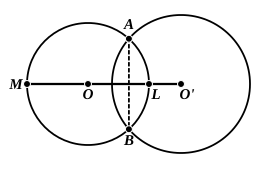

3. *If the distance between the centres of two circles is equal to the sum of the radii, the two circumferences have one point common and one only, and that point is on the line of centres. Each circle is external to the other.*

Let $O, O'$ be the centres, $r, r'$ the radii of the circles, so that $OO'$ is equal to $r + r'$.

Thus $OO'$ is greater than $r$, so that $O'$ is external to the circle $O$, and the circumference of the circle $O$ cuts $OO'$ in a point $A$.

And, since $OO'$ is equal to $r + r'$, and $OA$ to $r$, it follows that $O'A$ is equal to $r'$, so that $A$ belongs also to the circumference of the circle $O'$.

The proof that all other points on, and all points within, the circumference of the circle $O$ are external to the circle $O'$ follows the similar proof of prop. 1 above. And similarly all points (except $A$) on, and all points within, the circumference of the circle $O'$ are external to the circle $O$.

The two circles, having one common point only, *touch* at that point, which lies, as shown, on the line of centres. And, since the circles are external to one another, they touch *externally*.

4. *If the distance between the centres of two unequal circles is equal to the difference between the radii, the two circumferences have one point and one only in common, and that point lies on the line of centres. The lesser circle is within the other.*

The proof is that of prop. 2 above, *mutatis mutandis*.

The circles here touch *internally* at the point on the line of centres.

5. *If the distance between the centres of two circles is less than the sum, and greater than the difference, of the radii, the two circumferences have two common points symmetrically situated with respect to the line of centres but not lying on that line.*

Let $O, O'$ be the centres of the two circles, $r, r'$ their radii, $r'$ being the greater, so that
$$r' - r < OO' < r + r'.$$

It follows that in any case $OO + r > r'$, so that, if $OM$ be taken on $O'O$ produced equal to $r$ (so that $M$ is on the circumference of the circle $O$), $M$ is external to the circle $O'$.

We have to use the same Postulate as in Eucl. I. 1 that

*An arc of a circle which has one extremity within and the other without a given circle has one point common with the latter and only one*; from which it follows, if we consider two such arcs making a complete circumference, that, *if a circumference of a circle passes through one point internal to, and one point external to a given circle, it cuts the latter circle in two points.*

We have then to prove that the circle $O$, besides having one point $M$ of its circumference external to the circle $O'$, has one other point of its circumference ($L$) internal to the latter circle.
