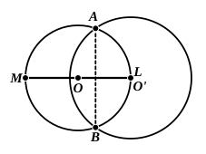

Three cases have to be distinguished according as $OO'$ is greater than, equal to, or less than, the radius $r$ of the lesser circle.

(1) $OO' > r$. (See the preceding figure.)
Measure $OL$ along $OO'$ equal to $r$, so that $L$ lies on the circumference of the circle $O$.

Then, since $OO' < r + r'$, $O'L$ will be less than $r'$, so that $L$ is within the circle $O'$.

(2) $OO' = r$.
In this case the circumference of the circle $O$ passes through $O'$, or $L$ coincides with $O'$.

(3) $OO' < r$.
If we measure $OL$ along $OO'$ equal to $r$, the point $L$ will lie on the circumference of the circle $O$.

Then $O'L = r - OO'$,
so that $O'L < r$, and *a fortiori* $O'L < r'$, so that $L$ lies within the circle $O'$.

Thus, in all three cases, since the circumference of $O$ passes through one point ($M$) external to, and one point ($L$) internal to, the circle $O'$, the two circumferences intersect in two points $A, B$ [Post.].

And $A, B$ cannot lie on the line of centres $OO'$, since this straight line intersects the circle $O$ in $L, M$ only, and of these points one is inside, the other outside, the circle $O'$.

Since $AB$ is a common chord of both circles, the straight line bisecting it at right angles passes through both centres, i.e. is identical with $OO'$.

And again by means of III. 7, 8 we prove that all points except $A, B$ on the arc $ALB$ lie within the circle $O'$, and all points except $A, B$ on the arc $AMB$ outside that circle; and so on.

---

## PROPOSITION 13.

A circle does not touch a circle at more points than one, 
whether it touch it internally or externally.

For, if possible, let the circle $ABDC$ touch the circle
$EBFD$, first internally, at more
5 points than one, namely $D, B$.

Let the centre $G$ of the circle
$ABDC$, and the centre $H$ of
$EBFD$, be taken.

Therefore the straight line
10 joined from $G$ to $H$ will fall on
$B, D$. [III. 11]

Let it so fall, as $BGHD$.

Then, since the point $G$ is
the centre of the circle $ABCD$,

15 $BG$ is equal to $GD$;

