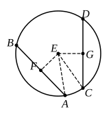

and let it be $E$; from $E$ let $EF, EG$ be drawn perpendicular
to $AB, CD$, and let $AE, EC$ be joined.

Then, since a straight line $EF$ through
the centre cuts a straight line $AB$ not through
the centre at right angles, it also bisects it. [III. 3]

Therefore $AF$ is equal to $FB$; 
therefore $AB$ is double of $AF$.

For the same reason

$CD$ is also double of $CG$;

and $AB$ is equal to $CD$;

therefore $AF$ is also equal to $CG$.

And, since $AE$ is equal to $EC$,

the square on $AE$ is also equal to the square on $EC$.

But the squares on $AF, EF$ are equal to the square on $AE$,
for the angle at $F$ is right;
and the squares on $EG, GC$ are equal to the square on $EC$,
for the angle at $G$ is right; [I. 47]

therefore the squares on $AF, FE$ are equal to the 
squares on $CG, GE$,

of which the square on $AF$ is equal to the square on $CG$,
for $AF$ is equal to $CG$;

therefore the square on $FE$ which remains is equal to 
the square on $EG$,

therefore $EF$ is equal to $EG$.

But in a circle straight lines are said to be equally distant
from the centre when the perpendiculars drawn to them from
the centre are equal; [III. Def. 4]

therefore $AB, CD$ are equally distant from the centre.

Next, let the straight lines $AB, CD$ be equally distant
from the centre; that is, let $EF$ be equal to $EG$.

I say that $AB$ is also equal to $CD$.

For, with the same construction, we can prove, similarly,
that $AB$ is double of $AF$, and $CD$ of $CG$.

And, since $AE$ is equal to $CE$,

the square on $AE$ is equal to the square on $CE$.

But the squares on $EF, FA$ are equal to the square on $AE$,
and the squares on $EG, GC$ equal to the square on $CE$. [I. 47]

