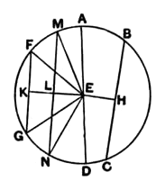

Therefore the squares on $EF$, $FA$ are equal to the squares on $EG$, $GC$,
of which the square on $EF$ is equal to the square on $EG$, for $EF$ is equal to $EG$;
therefore the square on $AF$ which remains is equal to the square on $CG$;
therefore $AF$ is equal to $CG$.

And $AB$ is double of $AF$, and $CD$ double of $CG$;
therefore $AB$ is equal to $CD$.

Therefore etc.

Q. E. D.

---

Heron (an-Nairīzī, pp. 125—7) has an elaborate addition to this proposition in which he proves, first by *reductio ad absurdum*, and then directly, that the centre of the circle falls between the two chords.

---

### PROPOSITION 15.

*Of straight lines[^37_1] in a circle the diameter is greatest, and of the rest the nearer to the centre is always greater than the more remote.*

Let $ABCD$ be a circle, let $AD$ be its diameter and $E$ the centre; and let $BC$ be nearer to the diameter $AD$[^37_5], and $FG$ more remote;
I say that $AD$ is greatest and $BC$ greater than $FG$.

For from the centre $E$ let $EH$, $EK$ be drawn perpendicular to $BC$, $FG$.

Then, since $BC$ is nearer to the centre and $FG$ more remote, $EK$ is greater than $EH$. [III. Def. 5]

Let $EL$ be made equal to $EH$, through $L$ let $LM$ be drawn at right angles to $EK$ and carried through to $N$, and let $ME$, $EN$, $FE$, $EG$ be joined.

Then, since $EH$ is equal to $EL$,
$BC$ is also equal to $MN$. [III. 14]

Again, since $AE$ is equal to $EM$, and $ED$ to $EN$,
$AD$ is equal to $ME$, $EN$.
