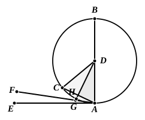

I say that the straight line drawn from $A$ at right angles
to $AB$ from its extremity will fall
outside the circle.

For suppose it does not, but,
if possible, let it fall within as $CA$,
and let $DC$ be joined.

Since $DA$ is equal to $DC$,
the angle $DAC$ is also equal to
the angle $ACD$. [I. 5]

But the angle $DAC$ is right;

therefore the angle $ACD$ is also right:

thus, in the triangle $ACD$, the two angles $DAC, ACD$ are
equal to two right angles: which is impossible. [I. 17]

Therefore the straight line drawn from the point $A$ at
right angles to $BA$ will not fall within the circle.

Similarly we can prove that neither will it fall on the
circumference;

therefore it will fall outside.

Let it fall as $AE$;
I say next that into the space between the straight line $AE$
and the circumference $CHA$ another straight line cannot be
interposed.

For, if possible, let another straight line be so interposed,
as $FA$, and let $DG$ be drawn from the point $D$ perpendicular
to $FA$.

Then, since the angle $AGD$ is right,

and the angle $DAG$ is less than a right angle,

$AD$ is greater than $DG$. [I. 19]

But $DA$ is equal to $DH$;
therefore $DH$ is greater than $DG$, the less than the
greater: which is impossible.

Therefore another straight line cannot be interposed into
the space between the straight line and the circumference.

I say further that the angle of the semicircle contained by
the straight line $BA$ and the circumference $CHA$ is greater
than any acute rectilineal angle,
and the remaining angle contained by the circumference $CHA$
and the straight line $AE$ is less than any acute rectilineal angle.

For, if there is any rectilineal angle greater than the
angle contained by the straight line $BA$ and the circumference

