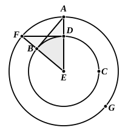

The words usually given as a part of the corollary "and that a straight line touches a circle at one point only, since in fact the straight line meeting it in two points was proved to fall within it" are omitted by Heiberg as being an undoubted addition of Theon's. It was Simson who added the further remark that "it is evident that there can be but one straight line which touches the circle at the same point."

---

## PROPOSITION 17.

From a given point to draw a straight line touching a 
given circle.

Let $A$ be the given point, and $BCD$ the given circle; thus it is required to draw from the point $A$ a straight line touching the circle $BCD$.

For let the centre $E$ of the circle be taken; [III. 1]
let $AE$ be joined, and with centre $E$ and distance $EA$ let the circle $AFG$ be described;
from $D$ let $DF$ be drawn at right angles to $EA$,
and let $EF$, $AB$ be joined;
I say that $AB$ has been drawn from the point $A$ touching the circle $BCD$.

For, since $E$ is the centre of the circles $BCD$, $AFG$,
$EA$ is equal to $EF$, and $ED$ to $EB$;
therefore the two sides $AE$, $EB$ are equal to the two sides $FE$, $ED$:
and they contain a common angle, the angle at $E$;
therefore the base $DF$ is equal to the base $AB$,
and the triangle ">$DEF$ is equal to the triangle ">$BEA$,
and the remaining angles to the remaining angles; [I. 4]
therefore the angle $EDF$ is equal to the angle $EBA$.

But the angle $EDF$ is right;
therefore the angle $EBA$ is also right.

Now $EB$ is a radius;
and the straight line drawn at right angles to the diameter of a circle, from its extremity, touches the circle; [III. 16, Por.]
therefore $AB$ touches the circle $BCD$.

Therefore from the given point $A$ the straight line $AB$ has been drawn touching the circle $BCD$.
