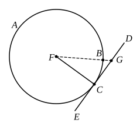

The construction shows, of course, that two straight lines can be drawn from a given external point to touch a given circle; and it is equally obvious that these two straight lines are equal in length and equally inclined to the straight line joining the external point to the centre of the given circle. These facts are given by Heron (an-Nairīzī, p. 130).

It is true that Euclid leaves out the case where the given point lies *on* the circumference of the circle, doubtless because the construction is so directly indicated by III. 16, Por. as to be scarcely worth a separate statement.

An easier solution is of course possible as soon as we know (III. 31) that the angle in a semicircle is a right angle; for we have only to describe a circle on $AE$ as diameter, and this circle cuts the given circle in the two points of contact.

---

### PROPOSITION 18.

*If a straight line touch a circle, and a straight line be joined from the centre to the point of contact, the straight line so joined will be perpendicular to the tangent.*[^45_3]

For let a straight line $DE$ touch the circle $ABC$ at the point $C$, let the centre $F$ of the circle $ABC$ be taken, and let $FC$ be joined from $F$ to $C$;
I say that $FC$ is perpendicular to $DE$.

For, if not, let $FG$ be drawn from $F$ perpendicular to $DE$.

Then, since the angle $FGC$ is right,
the angle $FCG$ is acute; [I. 17]
and the greater angle is subtended by the greater side; [I. 19]
therefore $FC$ is greater than $FG$.

But $FC$ is equal to $FB$;
therefore $FB$ is also greater than $FG$,
the less than the greater: which is impossible.

Therefore $FG$ is not perpendicular to $DE$.

Similarly we can prove that neither is any other straight line except $FC$;
therefore $FC$ is perpendicular to $DE$.

Therefore etc.

Q. E. D.
