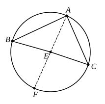

produce (1); while again we may enunciate a second partial converse of III. 18, corresponding to the statement that (1) and (3) produce (2), to the effect that a straight line drawn through the centre perpendicular to the tangent passes through the point of contact.

We may add at this point, or even after the Porism to III. 16, the theorem that *two circles which touch one another internally or externally have a common tangent at their point of contact*. For the line joining their centres, produced if necessary, passes through their point of contact, and a straight line drawn through that point at right angles to the line of centres is a tangent to both circles.

---

### PROPOSITION 20.

*In a circle the angle at the centre is double of the angle at the circumference, when the angles have the same circumference as base.*

Let $ABC$ be a circle, let the angle $BEC$ be an angle 5 at its centre, and the angle $BAC$ an angle at the circumference, and let them have the same circumference $BC$ as base;
I say that the angle $BEC$ is double of 10 the angle $BAC$.

For let $AE$ be joined and drawn through to $F$.

Then, since $EA$ is equal to $EB$,
the angle $EAB$ is also equal to the 15 angle $EBA$; [I. 5]
therefore the angles $EAB$, $EBA$ are double of the angle $EAB$.

But the angle $BEF$ is equal to the angles $EAB$, $EBA$; [I. 32]
therefore the angle $BEF$ is also double of the angle 20 $EAB$.

For the same reason
the angle $FEC$ is also double of the angle $EAC$.

Therefore the whole angle $BEC$ is double of the whole angle $BAC$.

25 Again let another straight line be inflected,[^47_25] and let there be another angle $BDC$; let $DE$ be joined and produced to $G$.
