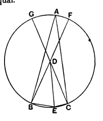

*Proof.* Since $CD$ is equal to $ED$,
the angles $DCE$, $DEC$ are equal.

Therefore the exterior angle $GDE$ is equal to twice the angle $DEC$.
Similarly the exterior angle $FDE$ is equal to twice the angle $DEB$.
By addition, the angles $GDE$, $FDE$ are double of the angle $BEC$.

But
the angle $BDC$ is equal to the angle $FDG$,
therefore *the sum of the angles $\text{BDG}$, $\text{GDF}$, $\text{FDC}$ is double of the angle $\text{BEC}$*.

And Euclid has proved the first part of the proposition, namely that the angle $BDC$ is double of the angle $BAC$.

Now, says Heron, $BAC$ is *any* angle in the segment $BAC$, and therefore *any* angle in the segment $BAC$ is half of the angle $BDC$.
Therefore all the angles in the segment $BAC$ are equal.

Again, $BEC$ is *any* angle in the segment $BEC$ and is equal to *half the sum of the angles* $\text{BDG}$, $\text{GDF}$, $\text{FDC}$.
Therefore all the angles in the segment $BEC$ are equal.
Hence III. 21 is proved *generally*.

Lastly, says Heron,
since *the sum of the angles* $\text{BDG}$, $\text{GDF}$, $\text{FDC}$ is double of the angle $BEC$,
and the angle $BDC$ is double of the angle $BAC$,
therefore, by addition, the *sum of four right angles* is double of the sum of the angles $BAC$, $BEC$.

Hence the angles $BAC$, $BEC$ are together equal to two right angles, and III. 22 is proved.

The above notes of Heron show conclusively, if proof were wanted, that Euclid had no idea of III. 20 applying *in terms* (either as a matter of enunciation or proof) to the case where the angle at the circumference, or the angle in the segment, is *obtuse*. He would not have recognised the "angle" greater than two right angles or the so-called "straight angle" as being an *angle* at all. This is indeed clear from his definition of an angle as the *inclination* κ.τ.ἑ., and from the language used by other later Greek mathematicians where there would be an opportunity for introducing the extension. Thus Proclus' notion of a "four-sided triangle" (cf. the note above on the definition of a triangle) shows that he did not count a re-entrant angle as an angle, and Zenodorus' application to the same figure of the word "hollow-angled" shows that in that case it was the exterior angle only which he would have called an angle. Further it would have been inconvenient to have introduced at the beginning of the *Elements* an "angle" equal to or greater than two right angles, because other definitions, e.g. that of a *right angle*, would have needed a qualification. If an "angle" might be equal to two right angles, one straight line in a straight line with another would have satisfied Euclid's definition of a right angle. This is noticed by Dodgson (p. 160), but it is practically brought out by Proclus on I. 13. "For he did not merely say that 'any straight line standing on a straight line either makes two right angles or angles equal to two right angles' but '*if it make angles*.'
