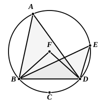

If it stand on the straight line at its extremity and make one angle, is it possible for this to be equal to two right angles? It is of course impossible; *for every rectilineal angle is less than two right angles*, as every solid angle is less than four right angles (p. 292, 13—20)." [It is true that it has been generally held that the meaning of "angle" is tacitly extended in VI. 33, but there is no real ground for this view. See the note on the proposition.]

It will be observed that, following his usual habit, Euclid omits the demonstration of the case which some editors, e.g. Clavius, have thought it necessary to give separately, the case namely where one of the lines forming the angle in the segment passes through the centre. Euclid's proof gives so obviously the means of proving this that it is properly left out.

Todhunter observes, what Clavius had also remarked, that there are two assumptions in the proof of III. 20, namely that, if $A$ is double of $B$ and $C$ double of $D$, then the sum, or difference, of $A$ and $C$ is equal to double the sum, or difference, of $B$ and $D$ respectively, the assumptions being particular cases of V. 1 and V. 5. But of course it is easy to satisfy ourselves of the correctness of the assumption without any recourse to Book V.

---

## PROPOSITION 21.

In a circle the angles in the same segment are equal to one 
another.

Let $ABCD$ be a circle, and let the angles $BAD, BED$
be angles in the same segment $BAED$;
I say that the angles $BAD, BED$ are
equal to one another.

For let the centre of the circle
$ABCD$ be taken, and let it be $F$; let
$BF, FD$ be joined.

Now, since the angle $BFD$ is at
the centre,
and the angle $BAD$ at the circum-
ference,

and they have the same circumference $BCD$ as base,

therefore the angle $BFD$ is double of the angle $BAD$. [III. 20]

For the same reason

the angle $BFD$ is also double of the angle $BED$; 
therefore the angle $BAD$ is equal to the angle $BED$.

Therefore etc. Q. E. D.

---

Under the restriction that the "angle at the centre" used in III. 20 must be less than two right angles, Euclid's proof of this proposition only applies to the case of a segment greater than a semicircle, and the case of a segment equal to or less than a semicircle has to be considered separately. The simplest proof, of many, seems to be that of Simson.
