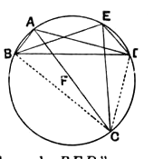
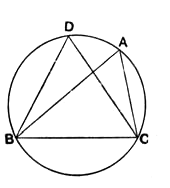
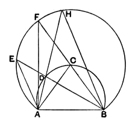

“But, if the segment $BAED$ be not greater than a semicircle, let $BAD$, $BED$ be angles in it: these also are equal to one another.

Draw $AF$ to the centre, and produce it to $C$, and join $CE$.

Therefore the segment $BADC$ is greater than a semicircle, and the angles in it $BAC$, $BEC$ are equal, by the first case.

For the same reason, because $CBED$ is greater than a semicircle,
the angles $CAD$, $CED$ are equal.
Therefore the whole angle $BAD$ is equal to the whole angle $BED$.”

We can prove, by means of *reductio ad absurdum*, the important converse of this proposition, namely that, *if there be any two triangles on the same base and on the same side of it, and with equal vertical angles, the circle passing through the extremities of the base and the vertex of one triangle will pass through the vertex of the other triangle also*. That a circle can be thus described about a triangle is clear from Euclid's construction in III. 9, which shows how to draw a circle passing through any three points, though it is in IV. 5 only that we have the problem stated. Now, suppose a circle $BAC$ drawn through the angular points of a triangle $BAC$, and let $BDC$ be another triangle with the same base $BC$ and on the same side of it, and having its vertical angle $D$ equal to the angle $A$. Then shall the circle pass through $D$.

For, if it does not, it must pass through some point $E$ on $BD$ or on $BD$ produced. If then $EC$ be joined, the angle $BEC$ is equal to the angle $BAC$, by III. 21, and therefore equal to the angle $BDC$. Therefore an exterior angle of a triangle is equal to the interior and opposite angle: which is impossible, by I. 16.
Therefore $D$ lies on the circle $BAC$.

Similarly for any other triangle on the base $BC$ and with vertical angle equal to $A$. Thus, *if any number of triangles be constructed on the same base and on the same side of it, with equal vertical angles, the vertices will all lie on the circumference of a segment of a circle*.

A useful theorem derivable from III. 21 is given by Serenus (*De sectione coni*, Props. 52, 53).

If $ADB$ be any segment of a circle, and $C$ be such a point on the circumference that $AC$ is equal to $CB$, and if there be described with $C$ as centre and radius $CA$ or $CB$ the circle $AHB$, then, $ADB$ being any other angle in the segment $ACB$, and $BD$ being produced to meet the outer segment in $E$, the sum of $AD$, $DB$ is equal to $BE$.

If $BC$ be produced to meet the outer segment in $F$, and $FA$ be joined,
$CA$, $CB$, $CF$ are by hypothesis equal.
Therefore the angle $FAC$ is equal to the angle $AFC$.
Also, by III. 21, the angles $ACB$, $ADB$ are equal;
