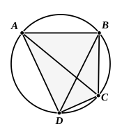

the three angles $CAB$, $ABC$, $BCA$ of the triangle ">$ABC$ are equal to two right angles.

But the angle $CAB$ is equal to the angle $BDC$, for they are in the same segment $BADC$; [III. 21]
and the angle $ACB$ is equal to the angle $ADB$, for they are in the same segment $ADCB$;
therefore the whole angle $ADC$ is equal to the angles $BAC$, $ACB$.

Let the angle $ABC$ be added to each;
therefore the angles $ABC$, $BAC$, $ACB$ are equal to the angles $ABC$, $ADC$.
But the angles $ABC$, $BAC$, $ACB$ are equal to two right angles;
therefore the angles $ABC$, $ADC$ are also equal to two right angles.

Similarly we can prove that the angles $BAD$, $DCB$ are also equal to two right angles.

Therefore etc. Q. E. D.

---

As Todhunter remarks, the converse of this proposition is true and very important: *if two opposite angles of a quadrilateral be together equal to two right angles, a circle may be circumscribed about the quadrilateral*. We can, by the method of III. 9, or by IV. 5, circumscribe a circle about the triangle ">$ABC$; and we can then prove, by *reductio ad absurdum*, that the circle passes through the fourth angular point $D$.

---

## PROPOSITION 23.

On the same straight line there cannot be constructed two 
similar and unequal segments of circles on the same side.

For, if possible, on the same straight line $AB$ let two similar and unequal segments of circles $ACB$, $ADB$ be constructed on the same side;
let $ACD$ be drawn through, and let $CB$, $DB$ be joined.

Then, since the segment $ACB$ is similar to the segment $ADB$,
