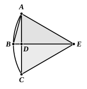

the angle $ABD$ is then greater than, equal to, or less than the angle $BAD$.

First let it be greater;
and on the straight line $BA$, and at the point $A$ on it, let the angle $BAE$ be constructed equal to the angle $ABD$; let $DB$ be drawn through to $E$, and let $EC$ be joined.

Then, since the angle $ABE$ is equal to the angle $BAE$,
the straight line $EB$ is also equal to $EA$. [I. 6]

And, since $AD$ is equal to $DC$,
and $DE$ is common,
the two sides $AD$, $DE$ are equal to the two sides $CD$, $DE$ respectively;
and the angle $ADE$ is equal to the angle $CDE$, for each is right;
therefore the base $AE$ is equal to the base $CE$.

But $AE$ was proved equal to $BE$;
therefore $BE$ is also equal to $CE$;
therefore the three straight lines $AE$, $EB$, $EC$ are equal to one another.

Therefore the circle drawn with centre $E$ and distance one of the straight lines $AE$, $EB$, $EC$ will also pass through the remaining points and will have been completed. [III. 9]
Therefore, given a segment of a circle, the complete circle has been described.
And it is manifest that the segment $ABC$ is less than a semicircle, because the centre $E$ happens to be outside it.

Similarly, even if the angle $ABD$ be equal to the angle $BAD$,
$AD$ being equal to each of the two $BD$, $DC$,

the three straight lines $DA$, $DB$, $DC$ will be equal to one another,
$D$ will be the centre of the completed circle,
and $ABC$ will clearly be a semicircle.
