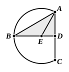

But, if the angle $ABD$ be less than the angle $BAD$,
and if we construct, on the straight line $BA$ and at the point $A$ on it, an angle equal to the angle $ABD$, the centre will fall on $DB$ within the segment $ABC$, and the segment $ABC$ will clearly be greater than a semicircle.

Therefore, given a segment of a circle, the complete circle has been described.[^56_1]
Q. E. F.

[^56_1]: 1. **to describe the complete circle**, προσαναγράψαι τὸν κύκλον, literally “to describe the circle *on to it*.”

---

It will be remembered that Simson takes first the case in which the angles $ABD$, $BAD$ are equal to one another, and then takes the other two cases together, telling us to “produce $BD$, if necessary.” This is a little shorter than Euclid's procedure, though Euclid does not repeat the proof of the first case in giving the third, but only refers to it as equally applicable.

Campanus, Peletarius and others give the solution of this problem in which we take two chords not parallel and bisect each at right angles by straight lines, which must meet in the centre, since each contains the centre and they only intersect in one point. Clavius, Billingsley, Barrow and others give the rather simpler solution in which the two chords have one extremity common (cf. Euclid's proofs of III. 9, 10). This method De Morgan favours, and (as noted on III. 1 above) would make III. 1, this proposition, and IV. 5 all *corollaries* of the theorem that “the line which bisects a chord perpendicularly must contain the centre.” Mr H. M. Taylor practically adopts this order and method, though he finds the centre of a circle by means of any two non-parallel chords; but he finds *the centre of the circle of which a given arc is a part* (his proposition corresponding to III. 25) by bisecting at right angles first the base and then the chord joining one extremity of the base to the point in which the line bisecting the base at right angles meets the circumference of the segment. Under De Morgan's alternative the relation between Euclid III. 1 and the Porism to it would be reversed, and Euclid's notion of a Porism or *corollary* would have to be considerably extended.

If the problem is solved after the manner of IV. 5, it is still desirable to state, as Euclid does, after proving $AE$, $EB$, $EC$ to be all equal, that “the circle drawn with centre $E$ and distance one of the straight lines $AE$, $EB$, $EC$ *will also pass through the remaining points of the segment*” [III. 9], in order to show that part of the circle described actually coincides with the given segment. This is not so clear if the centre is determined as the intersection of the straight lines bisecting at right angles chords which join pairs of *four* different points.

---

## PROPOSITION 26.

*In equal circles equal angles stand on equal circumferences, whether they stand at the centres or at the circumferences.*
