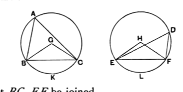

Let $ABC$, $DEF$ be equal circles, and in them let there be equal angles, namely at the centres the angles $BGC$, $EHF$, and at the circumferences the angles $BAC$, $EDF$;
I say that the circumference $BKC$ is equal to the circumference $ELF$.

For let $BC$, $EF$ be joined.

Now, since the circles $ABC$, $DEF$ are equal,
the radii are equal.

Thus the two straight lines $BG$, $GC$ are equal to the two straight lines $EH$, $HF$;
and the angle at $G$ is equal to the angle at $H$;
therefore the base $BC$ is equal to the base $EF$. [I. 4]

And, since the angle at $A$ is equal to the angle at $D$,
the segment $BAC$ is similar to the segment $EDF$; [III. Def. 11]
and they are upon equal straight lines.

But similar segments of circles on equal straight lines are equal to one another; [III. 24]
therefore the segment $BAC$ is equal to $EDF$.

But the whole circle $ABC$ is also equal to the whole circle $DEF$;
therefore the circumference $BKC$ which remains is equal to the circumference $ELF$.

Therefore etc.

Q. E. D.

---

As in III. 21, if Euclid's proof is to cover all cases, it requires us to take cognisance of "angles at the centre" which are equal to or greater than two right angles. Otherwise we must deal separately with the cases where the angle at the circumference is equal to or greater than a right angle. The case of an *obtuse* angle at the circumference can of course be reduced by means of III. 22 to the case of an acute angle at the circumference; and, in case the angle at the circumference is right, it is readily proved, by drawing the radii to the vertex of the angle and to the other extremities of the lines containing it, that the latter two radii are in a straight line, whence they make equal bases in the two circles as in Euclid's proof.
