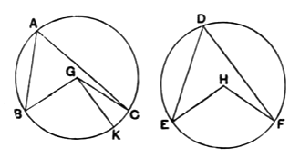

Lardner has another way of dealing with the right angle or obtuse angle at the circumference. In either case, he says, "bisect them, and the halves of them are equal, and it can be proved, as above, that the arcs upon which these halves stand are equal, whence it follows that the arcs on which the given angles stand are equal."

---

### PROPOSITION 27.

*In equal circles angles standing on equal circumferences are equal to one another, whether they stand at the centres or at the circumferences.*

For in equal circles $ABC$, $DEF$, on equal circumferences $BC$, $EF$, let the angles $BGC$, $EHF$ stand at the centres $G$, $H$, and the angles $BAC$, $EDF$ at the circumferences;
I say that the angle $BGC$ is equal to the angle $EHF$,
and the angle $BAC$ is equal to the angle $EDF$.

For, if the angle $BGC$ is unequal to the angle $EHF$,
one of them is greater.
Let the angle $BGC$ be greater: and on the straight line $BG$, and at the point $G$ on it, let the angle $BGK$ be constructed equal to the angle $EHF$. [I. 23]

Now equal angles stand on equal circumferences, when they are at the centres; [III. 26]
therefore the circumference $BK$ is equal to the circumference $EF$.

But $EF$ is equal to $BC$;
therefore $BK$ is also equal to $BC$, the less to the greater: which is impossible.

Therefore the angle $BGC$ is not unequal to the angle $EHF$;
therefore it is equal to it.
