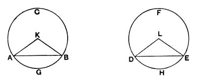

And the angle at $A$ is half of the angle $BGC$,
and the angle at $D$ half of the angle $EHF$; [III. 20]
therefore the angle at $A$ is also equal to the angle at $D$.

Therefore etc.

Q. E. D.

---

This proposition is the converse of the preceding one, and the remarks about the method of treating the different cases apply here also.

---

### PROPOSITION 28.

*In equal circles equal straight lines cut off equal circumferences, the greater equal to the greater and the less to the less.*

Let $ABC$, $DEF$ be equal circles, and in the circles let $AB$, $DE$ be equal straight lines cutting off $ACB$, $DFE$ as greater circumferences and $AGB$, $DHE$ as lesser;
I say that the greater circumference $ACB$ is equal to the greater circumference $DFE$, and the less circumference $AGB$ to $DHE$.

For let the centres $K$, $L$ of the circles be taken, and let $AK$, $KB$, $DL$, $LE$ be joined.

Now, since the circles are equal,
the radii are also equal;
therefore the two sides $AK$, $KB$ are equal to the two sides $DL$, $LE$;
and the base $AB$ is equal to the base $DE$;
therefore the angle $AKB$ is equal to the angle $DLE$. [I. 8]

But equal angles stand on equal circumferences, when they are at the centres; [III. 26]
therefore the circumference $AGB$ is equal to $DHE$.
