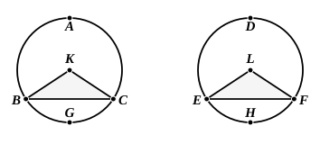

And the whole circle $ABC$ is also equal to the whole
circle $DEF$;
therefore the circumference $ACB$ which remains is also equal
to the circumference $DFE$ which remains.

Therefore etc. Q. E. D.

---

Euclid's proof does not in terms cover the particular case in which the chord in one circle passes through its centre; but indeed this was scarcely worth giving, as the proof can easily be supplied. Since the chord in one circle passes through its centre, the chord in the second circle must also be a diameter of that circle, for equal circles are those which have equal diameters, and all other chords in any circle are less than its diameter [III. 15]; hence the segments cut off in each circle are semicircles, and these must be equal because the circles are equal.

---

## PROPOSITION 29.

In equal circles equal circumferences are subtended by equal 
straight lines.

Let $ABC$, $DEF$ be equal circles, and in them let equal
circumferences $BGC$, $EHF$ be cut off; and let the straight
lines $BC$, $EF$ be joined;
I say that $BC$ is equal to $EF$.

For let the centres of the circles be taken, and let them
be $K$, $L$; let $BK$, $KC$, $EL$, $LF$ be joined.

Now, since the circumference $BGC$ is equal to the
circumference $EHF$,

the angle $BKC$ is also equal to the angle $ELF$. [III. 27]

And, since the circles $ABC$, $DEF$ are equal,

the radii are also equal;

therefore the two sides $BK$, $KC$ are equal to the two sides
$EL$, $LF$; and they contain equal angles;

therefore the base $BC$ is equal to the base $EF$. [I. 4]

Therefore etc.

