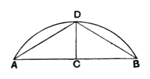

The particular case of this converse of III. 28 in which the given arcs are arcs of semicircles is even easier than the corresponding case of III. 28 itself.

The propositions III. 26—29 are of course equally true if the *same* circle is taken instead of *two equal* circles.

---

### PROPOSITION 30.

*To bisect a given circumference.*

Let $ADB$ be the given circumference;
thus it is required to bisect the circumference $ADB$.

Let $AB$ be joined and bisected at $C$; from the point $C$ let $CD$ be drawn at right angles to the straight line $AB$, and let $AD$, $DB$ be joined.

Then, since $AC$ is equal to $CB$, and $CD$ is common,
the two sides $AC$, $CD$ are equal to the two sides $BC$, $CD$;
and the angle $ACD$ is equal to the angle $BCD$, for each is right;
therefore the base $AD$ is equal to the base $DB$. [I. 4]

But equal straight lines cut off equal circumferences, the greater equal to the greater, and the less to the less; [III. 28]
and each of the circumferences $AD$, $DB$ is less than a semicircle;
therefore the circumference $AD$ is equal to the circumference $DB$.

Therefore the given circumference has been bisected at the point $D$.

Q. E. F.

---

### PROPOSITION 31.

*In a circle the angle in the semicircle is right, that in a greater segment less than a right angle, and that in a less segment greater than a right angle; and further the angle of the greater segment is greater than a right angle, and the angle of the less segment less than a right angle.*
