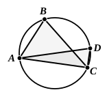

in the same segment are equal), which Euclid's more general proof does not need.

In the Greek texts before that of August there is an alternative proof that the angle $BAC$ (in a semicircle) is right. August and Heiberg relegate it to an Appendix.

"Since the angle $AEC$ is double of the angle $BAE$ (for it is equal to the two interior and opposite angles), while the angle $AEB$ is also double of the angle $EAC$,
the angles $AEB$, $AEC$ are double of the angle $BAC$.
But the angles $AEB$, $AEC$ are equal to two right angles;
therefore the angle $BAC$ is right."

Lardner gives a slightly different proof of the second part of the theorem.
If $ABC$ be a segment greater than a semicircle, draw the diameter $AD$, and join $CD$, $CA$.

Then, in the triangle $ACD$, the angle $ACD$ is right (being the angle in a semicircle);
therefore the angle $ADC$ is acute.
But the angle $ADC$ is equal to the angle $ABC$ in the same segment;
therefore the angle $ABC$ is acute.

Euclid's references in this proposition to the angle *of* a segment greater or less than a semicircle respectively seem, like the part of III. 16 relating to the angle *of* a semicircle, to be a survival of ancient controversies and not to be put in deliberately as being an essential part of elementary geometry. Cf. the notes on III. Def. 7 and III. 16.

The corollary ordinarily attached to this proposition is omitted by Heiberg as an interpolation of date later than Theon. It is to this effect: "From this it is manifest that, if one angle of a triangle be equal to the other two, the first angle is right because the exterior angle to it is also equal to the same angles, and if the adjacent angles be equal, they are right." No doubt the corollary is rightly suspected, because there is no necessity for it here, and the words ὅπερ ἔδει δεῖξαι come before it, not after it, as is usual with Euclid. But, on the other hand, as the fact stated does appear in the proof of III. 31, the Porism would be a Porism after the usual type, and I do not quite follow Heiberg's argument that, "if Euclid had wished to add it, he ought to have placed it after I. 32."

It has already been mentioned above (p. 44) that this proposition supplies us with an alternative construction for the problem in III. 17 of drawing the two tangents to a circle from an external point.

Two theorems of some historical interest which follow directly from III. 31 may be mentioned.

The first is a lemma of Pappus on "the 24th problem" of the second Book of Apollonius' lost treatise on νεύσεις (Pappus VII. p. 812) and is to this effect. If a circle, as $DEF$, pass through $D$, the centre of a circle $ABC$, and if through $F$, the other point in which the line of centres meets the circle $DEF$, any straight line be drawn (and produced if necessary) meeting the circle $DEF$ in $E$ and the circle $ABC$ in $B$, $G$,

