then $E$ is the middle point of $BG$. For, if $DE$ be joined, the angle $DEF$ (in a semicircle) is a right angle [III. 31]; and $DE$, being at right angles to the chord $BG$ of the circle $ABC$, also bisects it [III. 3].

The second is a proposition in the *Liber Assumptorum*, attributed (no doubt erroneously as regards much of it) to Archimedes, which has reached us through the Arabic (Archimedes, ed. Heiberg, II. pp. 520—521).

*If two chords $AB$, $CD$ in a circle intersect at right angles in a point $O$, then the sum of the squares on $AO$, $BO$, $CO$, $DO$ is equal to the square on the diameter.*

For draw the diameter $CE$, and join $AC$, $CB$, $AD$, $BE$.

Then the angle $CAO$ is equal to the angle $CEB$. (This follows, in the first figure, from III. 21 and, in the second, from I. 13 and III. 22.) Also the angle $COA$, being right, is equal to the angle $CBE$ which, being the angle in a semicircle, is also right [III. 31].

Therefore the triangles ">$AOC$, ">$EBC$ have two angles equal respectively; whence the third angles $ACO$, $ECB$ are equal. (In the second figure the angle $ACO$ is, by I. 13 and III. 22, equal to the angle $ABD$, and therefore the angles $ABD$, $ECB$ are equal.)

Therefore, in both figures, the arcs $AD$, $BE$, and consequently the chords $AD$, $BE$ subtended by them, are equal. [III. 26, 29]

Now the squares on $AO$, $DO$ are equal to the square on $AD$ [I. 47], that is, to the square on $BE$.

And the squares on $CO$, $BO$ are equal to the square on $BC$.

Therefore, by addition, the squares on $AO$, $BO$, $CO$, $DO$ are equal to the squares on $EB$, $BC$, i.e. to the square on $CE$. [I. 47]

---

### PROPOSITION 32.

If a straight line touch a circle, and from the point of 
contact there be drawn across, in the circle, a straight line 
cutting the circle, the angles which it makes with the tangent 
will be equal to the angles in the alternate segments of the 
circle.

For let a straight line $EF$ touch the circle $ABCD$ at the point $B$, and from the point $B$ let there be drawn across, in the circle $ABCD$, a straight line $BD$ cutting it;
I say that the angles which $BD$ makes with the tangent $EF$ will be equal to the angles in the alternate segments of the
