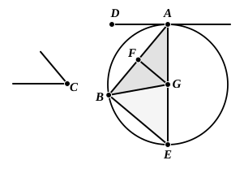

This can, as Camerer and Todhunter remark, be proved indirectly; or we may prove it, with Clavius, directly. Let $BD$ be the given chord, and let $EF$ be drawn through $B$ so that it makes with $BD$ angles equal to the angles in the alternate segments of the circle respectively.

Let $BA$ be the diameter through $B$, and let $C$ be any point on the circumference of the segment $DCB$ which does not contain $A$. Join $AD$, $DC$, $CB$.

Then, since, by hypothesis, the angle $FBD$ is equal to the angle $BAD$, let the angle $ABD$ be added to both;
therefore the angle $ABF$ is equal to the angles $ABD$, $BAD$.

But the angle $BDA$, being the angle in a semicircle, is a right angle;
therefore the remaining angles $ABD$, $BAD$ in the triangle $ABD$ are equal to a right angle.

Therefore the angle $ABF$ is right;
hence, since $BA$ is the diameter through $B$,
$EF$ touches the circle at $B$. [III. 16, Por.]

Pappus assumes in one place (IV. p. 196) the consequence of this proposition that, *If two circles touch, any straight line drawn through the point of contact and terminated by both circles cuts off segments in each which are respectively similar.* Pappus also shows how to prove this (VII. p. 826) by drawing the common tangent at the point of contact and using this proposition, III. 32.

---

### PROPOSITION 33.

*On a given straight line to describe a segment of a circle admitting an angle equal to a given rectilineal angle.*

Let $AB$ be the given straight line, and the angle at $C$ the given rectilineal angle;
thus it is required to describe on the given straight line $AB$ a segment of a circle admitting an angle equal to the angle at $C$.

The angle at $C$ is then acute, or right, or obtuse.

First let it be acute,
and, as in the first figure, on the straight line $AB$, and at the point $A$, let the angle $BAD$ be constructed equal to the angle at $C$;
therefore the angle $BAD$ is also acute.

Let $AE$ be drawn at right angles to $DA$, let $AB$ be
