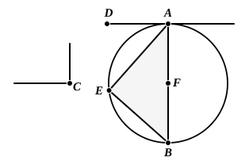

bisected at $F$, let $FG$ be drawn from the point $F$ at right
angles to $AB$, and let $GB$ be joined.

Then, since $AF$ is equal to $FB$,
and $FG$ is common,

the two sides $AF$, $FG$ are equal to the two sides $BF$, $FG$;

and the angle $AFG$ is equal to the angle $BFG$;

therefore the base $AG$ is equal to the base $BG$. [I. 4]

Therefore the circle described with centre $G$ and distance
$GA$ will pass through $B$ also.

Let it be drawn, and let it be $ABE$;
let $EB$ be joined.

Now, since $AD$ is drawn from $A$, the extremity of the
diameter $AE$, at right angles to $AE$,

therefore $AD$ touches the circle $ABE$. [III. 16, Por.]

Since then a straight line $AD$ touches the circle $ABE$,
and from the point of contact at $A$ a straight line $AB$ is
drawn across in the circle $ABE$,
the angle $DAB$ is equal to the angle $AEB$ in the alternate
segment of the circle. [III. 32]

But the angle $DAB$ is equal to the angle at $C$;
therefore the angle at $C$ is also equal to the angle $AEB$.

Therefore on the given straight line $AB$ the segment
$AEB$ of a circle has been described admitting the angle $AEB$
equal to the given angle, the angle at $C$.

Next let the angle at $C$ be right;

and let it be again required to describe on $AB$ a segment
of a circle admitting an angle equal to the right angle at $C$.

Let the angle $BAD$ be constructed equal to the right
angle at $C$, as is the case in the second figure;
