let $AB$ be bisected at $F$, and with centre $F$ and distance either $FA$ or $FB$ let the circle $AEB$ be described.

Therefore the straight line $AD$ touches the circle $ABE$, because the angle at $A$ is right. [III. 16, Por.]

And the angle $BAD$ is equal to the angle in the segment $AEB$, for the latter too is itself a right angle, being an angle in a semicircle. [III. 31]

But the angle $BAD$ is also equal to the angle at $C$.

Therefore the angle $AEB$ is also equal to the angle at $C$.

Therefore again the segment $AEB$ of a circle has been described on $AB$ admitting an angle equal to the angle at $C$.

Next, let the angle at $C$ be obtuse;

and on the straight line $AB$, and at the point $A$, let the angle $BAD$ be constructed equal to it, as is the case in the third figure;
let $AE$ be drawn at right angles to $AD$, let $AB$ be again bisected at $F$, let $FG$ be drawn at right angles to $AB$, and let $GB$ be joined.

Then, since $AF$ is again equal to $FB$,
and $FG$ is common,
the two sides $AF$, $FG$ are equal to the two sides $BF$, $FG$;
and the angle $AFG$ is equal to the angle $BFG$;
therefore the base $AG$ is equal to the base $BG$. [I. 4]

Therefore the circle described with centre $G$ and distance $GA$ will pass through $B$ also; let it so pass, as $AEB$.

Now, since $AD$ is drawn at right angles to the diameter $AE$ from its extremity,
$AD$ touches the circle $AEB$. [III. 16, Por.]

And $AB$ has been drawn across from the point of contact at $A$;
therefore the angle $BAD$ is equal to the angle constructed in the alternate segment $AHB$ of the circle. [III. 32]
