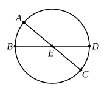

and $BC$ has been drawn across from the point of contact at $B$,
the angle $FBC$ is equal to the angle constructed in the alternate segment $BAC$. [III. 32]

But the angle $FBC$ is equal to the angle at $D$;
therefore the angle in the segment $BAC$ is equal to the angle at $D$.

Therefore from the given circle $ABC$ the segment $BAC$ has been cut off admitting an angle equal to the given rectilineal angle, the angle at $D$.

Q. E. F.

---

An alternative construction here would be to make an "angle at the centre" (in the extended sense, if necessary) double of the given angle; and, if the given angle is right, it is only necessary to draw a diameter of the circle.

---

### PROPOSITION 35.

If in a circle two straight lines cut one another, the 
rectangle contained by the segments of the one is equal to the 
rectangle contained by the segments of the other.

For in the circle $ABCD$ let the two straight lines $AC$, $BD$ cut one another at the point $E$;
I say that the rectangle contained by $AE$, $EC$ is equal to the rectangle contained by $DE$, $EB$.

If now $AC$, $BD$ are through the centre, so that $E$ is the centre of the circle $ABCD$,
it is manifest that, $AE$, $EC$, $DE$, $EB$ being equal,
the rectangle contained by $AE$, $EC$ is also equal to the rectangle contained by $DE$, $EB$.
