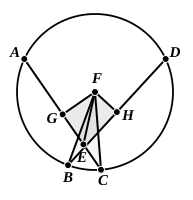

Next let $AC$, $DB$ not be through the centre;
let the centre of $ABCD$ be taken, and let it be $F$;
from $F$ let $FG$, $FH$ be drawn perpendicular to the straight lines $AC$, $DB$,
and let $FB$, $FC$, $FE$ be joined.

Then, since a straight line $GF$ through the centre cuts a straight line $AC$ not through the centre at right angles,
it also bisects it; [III. 3]
therefore $AG$ is equal to $GC$.

Since, then, the straight line $AC$ has been cut into equal parts at $G$ and into unequal parts at $E$,
the rectangle contained by $AE$, $EC$ together with the square on $EG$ is equal to the square on $GC$; [II. 5]

Let the square on $GF$ be added;
therefore the rectangle $AE$, $EC$ together with the squares on $GE$, $GF$ is equal to the squares on $CG$, $GF$.

But the square on $FE$ is equal to the squares on $EG$, $GF$, and the square on $FC$ is equal to the squares on $CG$, $GF$; [I. 47]
therefore the rectangle $AE$, $EC$ together with the square on $FE$ is equal to the square on $FC$.

And $FC$ is equal to $FB$;
therefore the rectangle $AE$, $EC$ together with the square on $EF$ is equal to the square on $FB$.

For the same reason, also,
the rectangle $DE$, $EB$ together with the square on $FE$ is equal to the square on $FB$.

But the rectangle $AE$, $EC$ together with the square on $FE$ was also proved equal to the square on $FB$;
therefore the rectangle $AE$, $EC$ together with the square on $FE$ is equal to the rectangle $DE$, $EB$ together with the square on $FE$.

Let the square on $FE$ be subtracted from each;
therefore the rectangle contained by $AE$, $EC$ which remains is equal to the rectangle contained by $DE$, $EB$.

Therefore etc.
