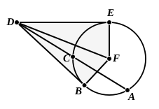

*the circle and the straight line intercepted on it outside between the point and the convex circumference be equal to the square on the straight line which falls on the circle, the straight line which falls on it will touch the circle.*

For let a point $D$ be taken outside the circle $ABC$;
from $D$ let the two straight lines $DCA$, $DB$ fall on the circle $ACB$;
let $DCA$ cut the circle and $DB$ fall on it; and let the rectangle $AD$, $DC$ be equal to the square on $DB$.

I say that $DB$ touches the circle $ABC$.

For let $DE$ be drawn touching $ABC$; let the centre of the circle $ABC$ be taken, and let it be $F$; let $FE$, $FB$, $FD$ be joined.

Thus the angle $FED$ is right. [III. 18]

Now, since $DE$ touches the circle $ABC$, and $DCA$ cuts it, the rectangle $AD$, $DC$ is equal to the square on $DE$. [III. 36]

But the rectangle $AD$, $DC$ was also equal to the square on $DB$;
therefore the square on $DE$ is equal to the square on $DB$;
therefore $DE$ is equal to $DB$.

And $FE$ is equal to $FB$;
therefore the two sides $DE$, $EF$ are equal to the two sides $DB$, $BF$;
and $FD$ is the common base of the triangles;
therefore the angle $DEF$ is equal to the angle $DBF$. [I. 8]

But the angle $DEF$ is right;
therefore the angle $DBF$ is also right.

And $FB$ produced is a diameter;
and the straight line drawn at right angles to the diameter of a circle, from its extremity, touches the circle; [III. 16, Por.]
therefore $DB$ touches the circle.

Similarly this can be proved to be the case even if the centre be on $AC$.

Therefore etc.

Q. E. D.

---

De Morgan observes that there is here the same defect as in I. 48, i.e. an apparent avoidance of indirect demonstration by drawing the tangent $DE$ on
