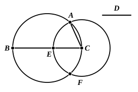

# BOOK IV. PROPOSITIONS

### PROPOSITION 1.

Into a given circle to fit a straight line equal to a given 
straight line which is not greater than the diameter of the 
circle.

Let $ABC$ be the given circle, and $D$ the given straight
line not greater than the diameter
of the circle;
thus it is required to fit into the
circle $ABC$ a straight line equal
to the straight line $D$.

Let a diameter $BC$ of the
circle $ABC$ be drawn.

Then, if $BC$ is equal to $D$,
that which was enjoined will have
been done; for $BC$ has been fitted into the circle $ABC$ equal
to the straight line $D$.

But, if $BC$ is greater than $D$,
let $CE$ be made equal to $D$, and with centre $C$ and distance
$CE$ let the circle $EAF$ be described;
let $CA$ be joined.

Then, since the point $C$ is the centre of the circle $EAF$,

$CA$ is equal to $CE$.

But $CE$ is equal to $D$;

therefore $D$ is also equal to $CA$.

Therefore into the given circle $ABC$ there has been fitted
$CA$ equal to the given straight line $D$.
