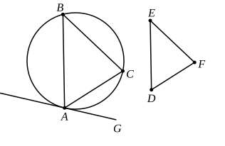

on the straight line $AH$, and at the point $A$ on it, let the angle $HAC$ be constructed equal to the angle $DEF$,
and on the straight line $AG$, and at the point $A$ on it, let the angle $GAB$ be constructed equal to the angle $DFE$; [I. 23]
let $BC$ be joined.

Then, since a straight line $AH$ touches the circle $ABC$, and from the point of contact at $A$ the straight line $AC$ is drawn across in the circle,
therefore the angle $HAC$ is equal to the angle $ABC$ in the alternate segment of the circle. [III. 32]

But the angle $HAC$ is equal to the angle $DEF$;
therefore the angle $ABC$ is also equal to the angle $DEF$.

For the same reason
the angle $ACB$ is also equal to the angle $DFE$;
therefore the remaining angle $BAC$ is also equal to the remaining angle $EDF$. [I. 32]

Therefore in the given circle there has been inscribed a 
triangle equiangular with the given triangle. Q. E. F.

---

Here again, since any point on the circle may be taken as an angular point of the triangle, there are an infinite number of solutions. Even when a particular point has been chosen to form one angular point, the required triangle may be constructed in six ways. For any one of the three angles may be placed at the point; and, whichever is placed there, the positions of the two others relatively to it may be interchanged. The sides of the triangle will, in all the different solutions, be of the same length respectively; only their relative positions will be different.

This problem can of course be reduced (as it was by Borelli) to III. 34, namely the problem of cutting off from a given circle a segment containing an angle equal to a given angle. It can also be solved by the alternative method applicable to III. 34 of drawing "angles at the centre" equal to double the angles of the given triangle respectively; and by this method we can easily solve this problem, or III. 34, with the further condition that one side of the
