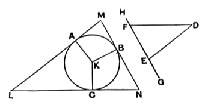

required triangle, or the base of the required segment, respectively, shall be parallel to a given straight line.

As a particular case, we can, by the method of this proposition, describe an *equilateral* triangle in any circle after we have first constructed any equilateral triangle by the aid of I. 1. The possibility of this is assumed in IV. 16. It is of course equivalent to dividing the circumference of a circle into *three equal parts*. As De Morgan says, the idea of dividing a revolution into equal parts should be kept prominent in considering Book IV.; this aspect of the construction of regular polygons is obvious enough, and the reason why the division of the circle into *three* equal parts is not given by Euclid is that it happens to be as easy to divide the circle into three parts which are in the ratio of the angles of any triangle as to divide it into three equal parts.

---

## PROPOSITION 3.

*About a given circle to circumscribe a triangle equiangular with a given triangle.*

Let $ABC$ be the given circle, and $DEF$ the given triangle;
5 thus it is required to circumscribe about the circle $ABC$ a triangle equiangular with the triangle $DEF$.

Let $EF$ be produced in both directions to the points $G, H$,
let the centre $K$ of the circle $ABC$ be taken [III. 1], and let 10 the straight line $KB$ be drawn across at random;
on the straight line $KB$, and at the point $K$ on it, let the angle $BKA$ be constructed equal to the angle $DEG$,
and the angle $BKC$ equal to the angle $DFH$; [I. 23]
and through the points $A, B, C$ let $LAM, MBN, NCL$ be 15 drawn touching the circle $ABC$. [III. 16, Por.]

Now, since $LM, MN, NL$ touch the circle $ABC$ at the points $A, B, C$,
and $KA, KB, KC$ have been joined from the centre $K$ to the points $A, B, C$,
