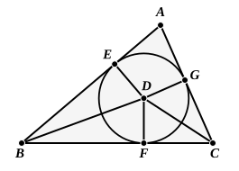

they will form *eight* triangles, two of which are the triangles *circumscribed* to the circle in the manner required in the proposition. The other six triangles are so related to the circle that the circle touches two of the sides in each *produced*, i.e. the circle is an *escribed* circle to each of the six triangles.

---

### PROPOSITION 4.

*In a given triangle to inscribe a circle.*

Let $ABC$ be the given triangle;
thus it is required to inscribe a circle in the triangle $ABC$.

Let the angles $ABC$, $ACB$
5 be bisected by the straight lines $BD$, $CD$ [I. 9], and let these meet one another at the point $D$;
from $D$ let $DE$, $DF$, $DG$ be drawn perpendicular to the straight
10 lines $AB$, $BC$, $CA$.

Now, since the angle $ABD$ is equal to the angle $CBD$,
and the right angle $BED$ is also equal to the right angle $BFD$,
15 $EBD$, $FBD$ are two triangles having two angles equal to two angles and one side equal to one side, namely that subtending one of the equal angles, which is $BD$ common to the triangles;
therefore they will also have the remaining sides equal to
20 the remaining sides; [I. 26]
therefore $DE$ is equal to $DF$.

For the same reason
$DG$ is also equal to $DF$.

Therefore the three straight lines $DE$, $DF$, $DG$ are equal
25 to one another;
therefore the circle described with centre $D$ and distance one of the straight lines $DE$, $DF$, $DG$ will pass also through the remaining points, and will touch the straight lines $AB$, $BC$, $CA$, because the angles at the points $E$, $F$, $G$
30 are right.

For, if it cuts them, the straight line drawn at right angles to the diameter of the circle from its extremity will be found to fall within the circle: which was proved absurd; [III. 16]
