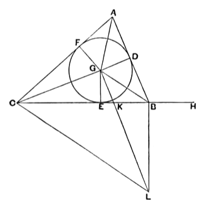

two sides *produced*. Next, taking the pairs of interior angles formed by a second side with the other two produced indefinitely, we get two circles satisfying the conditions, one of which is the same inscribed circle that we had before, while the other is a second escribed circle. Similarly with the third side. Hence we have the inscribed circle, and three escribed circles (one opposite each angle of the triangle), i.e. four circles in all, satisfying the conditions of the problem.

It may perhaps not be inappropriate to give at this point Heron's elegant proof of the formula for the area of a triangle in terms of the sides, which we usually write thus:

$$\Delta = \sqrt{s(s - a)(s - b)(s - c)},$$

although it requires the theory of proportions and uses some ungeometrical expressions, e.g. the product of two areas and the "side" of such a product, where of course the areas are so many square units of length. The proof is given in the *Metrica*, I. 8, and in the *Dioptra*, 30 (Heron, Vol. III., Teubner, 1903, pp. 20—24 and pp. 280—4, or Heron, ed. Hultsch, pp. 235—7).

Suppose the sides of the triangle $ABC$ to be given in length.

Inscribe the circle $DEF$, and let $G$ be its centre.

Join $AG$, $BG$, $CG$, $DG$, $EG$, $FG$.

Then

$$\begin{aligned}
BC \cdot EG &= 2 \cdot \Delta BGC, \\
CA \cdot FG &= 2 \cdot \Delta ACG, \\
AB \cdot DG &= 2 \cdot \Delta ABG.
\end{aligned}$$

Therefore, by addition,

$$p \cdot EG = 2 \cdot \Delta ABC,$$

where $p$ is the perimeter.

Produce $CB$ to $H$, so that $BH = AD$.

Then, since $AD = AF$, $DB = BE$, $FC = CE$,

$$CH = \tfrac{1}{2}p.$$

Hence

$$CH \cdot EG = \Delta ABC.$$
