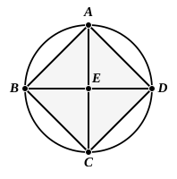

### PROPOSITION 6.

*In a given circle to inscribe a square.*

Let $ABCD$ be the given circle;
thus it is required to inscribe a square in the circle $ABCD$.

Let two diameters $AC$, $BD$ of the circle $ABCD$ be drawn at right angles to one another, and let $AB$, $BC$, $CD$, $DA$ be joined.

Then, since $BE$ is equal to $ED$, for $E$ is the centre,
and $EA$ is common and at right angles,
therefore the base $AB$ is equal to the base $AD$. [I. 4]

For the same reason
each of the straight lines $BC$, $CD$ is also equal to each of the straight lines $AB$, $AD$;
therefore the quadrilateral $ABCD$ is equilateral.

I say next that it is also right-angled.

For, since the straight line $BD$ is a diameter of the circle $ABCD$,
therefore $BAD$ is a semicircle;
therefore the angle $BAD$ is right. [III. 31]

For the same reason
each of the angles $ABC$, $BCD$, $CDA$ is also right;
therefore the quadrilateral $ABCD$ is right-angled.

But it was also proved equilateral;
therefore it is a square; [I. Def. 22]
and it has been inscribed in the circle $ABCD$.

Therefore in the given circle the square $ABCD$ has been inscribed.

Q. E. F.

---

Euclid here proceeds to consider problems corresponding to those in Props. 2—5 with reference to figures of four or more sides, but with the difference that, whereas he dealt with triangles of any form, he confines himself henceforth to regular figures. It happened to be as easy to divide a circle into *three* parts which are in the ratio of the angles, or of the supplements of the angles, of a triangle as into three *equal* parts. But, when it is required to inscribe in a circle a figure equiangular to a given *quadrilateral*, this can only be
