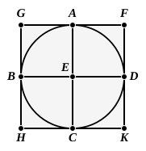

done provided that the quadrilateral has either pair of opposite angles equal to two right angles. Moreover, in this case, the problem *may* be solved in the same way as that of IV. 2, i.e. by simply inscribing a triangle equiangular to one of the triangles into which the quadrilateral is divided by either diagonal, and then drawing on the side corresponding to the diagonal as base another triangle equiangular to the other triangle contained in the quadrilateral. But this is not the *only* solution; there are an infinite number of other solutions in which the inscribed quadrilateral will, unlike that found by this particular method, not be of the same *form* as the given quadrilateral. For suppose $ABCD$ to be the quadrilateral inscribed in the circle by the method of IV. 2. Take *any* point $B'$ on $AB$, join $AB'$, and then make the angle $DAD'$ (measured towards $AC$) equal to the angle $BAB'$. Join $B'C$, $CD'$. Then $AB'CD'$ is also *equiangular* to the given quadrilateral, but not of the same *form*. Hence the problem is indeterminate in the case of the general quadrilateral. It is equally so if the given quadrilateral is a rectangle; and it is determinate only when the given quadrilateral is a *square*.

---

### PROPOSITION 7.

*About a given circle to circumscribe a square.*

Let $ABCD$ be the given circle;
thus it is required to circumscribe a square about the circle $ABCD$.

Let two diameters $AC$, $BD$ of the circle $ABCD$ be drawn at right angles to one another, and through the points $A$, $B$, $C$, $D$ let $FG$, $GH$, $HK$, $KF$ be drawn touching the circle $ABCD$. [III. 16, Por.]

Then, since $FG$ touches the circle $ABCD$,
and $EA$ has been joined from the centre $E$ to the point of contact at $A$,
therefore the angles at $A$ are right. [III. 18]

For the same reason
the angles at the points $B$, $C$, $D$ are also right.

Now, since the angle $AEB$ is right,
and the angle $EBG$ is also right,
therefore $GH$ is parallel to $AC$. [I. 28]
