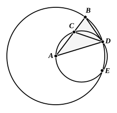

### PROPOSITION 10.

To construct an isosceles triangle having each of the angles 
at the base double of the remaining one.

Let any straight line $AB$ be set out, and let it be cut at
the point $C$ so that the rectangle
contained by $AB$, $BC$ is equal to
the square on $CA$; [II. 11]
with centre $A$ and distance $AB$ let
the circle $BDE$ be described,
and let there be fitted in the circle
$BDE$ the straight line $BD$ equal to
the straight line $AC$ which is not
greater than the diameter of the
circle $BDE$. [IV. 1]

Let $AD$, $DC$ be joined, and let
the circle $ACD$ be circumscribed about the triangle ">$ACD$.
[IV. 5]

Then, since the rectangle $AB$, $BC$ is equal to the square
on $AC$,
and $AC$ is equal to $BD$,

therefore the rectangle $AB$, $BC$ is equal to the square on $BD$.

And, since a point $B$ has been taken outside the circle
$ACD$,
and from $B$ the two straight lines $BA$, $BD$ have fallen on
the circle $ACD$, and one of them cuts it, while the other falls
on it,
and the rectangle $AB$, $BC$ is equal to the square on $BD$,

therefore $BD$ touches the circle $ACD$. [III. 37]

Since, then, $BD$ touches it, and $DC$ is drawn across
from the point of contact at $D$,

therefore the angle $BDC$ is equal to the angle $DAC$ in the 
alternate segment of the circle. [III. 32]

Since, then, the angle $BDC$ is equal to the angle $DAC$,

let the angle $CDA$ be added to each;

therefore the whole angle $BDA$ is equal to the two angles 
$CDA$, $DAC$.

