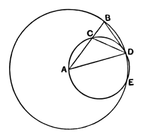

### PROPOSITION 10.

*To construct an isosceles triangle having each of the angles at the base double of the remaining one.*

Let any straight line $AB$ be set out, and let it be cut at the point $C$ so that the rectangle contained by $AB$, $BC$ is equal to the square on $CA$; [II. 11]
with centre $A$ and distance $AB$ let the circle $BDE$ be described,
and let there be fitted in the circle $BDE$ the straight line $BD$ equal to the straight line $AC$ which is not greater than the diameter of the circle $BDE$. [IV. 1]

Let $AD$, $DC$ be joined, and let the circle $ACD$ be circumscribed about the triangle $ACD$. [IV. 5]

Then, since the rectangle $AB$, $BC$ is equal to the square on $AC$,
and $AC$ is equal to $BD$,
therefore the rectangle $AB$, $BC$ is equal to the square on $BD$.

And, since a point $B$ has been taken outside the circle $ACD$,
and from $B$ the two straight lines $BA$, $BD$ have fallen on the circle $ACD$, and one of them cuts it, while the other falls on it,
and the rectangle $AB$, $BC$ is equal to the square on $BD$,
therefore $BD$ touches the circle $ACD$. [III. 37]

Since, then, $BD$ touches it, and $DC$ is drawn across from the point of contact at $D$,
therefore the angle $BDC$ is equal to the angle $DAC$ in the alternate segment of the circle. [III. 32]

Since, then, the angle $BDC$ is equal to the angle $DAC$,
let the angle $CDA$ be added to each;
therefore the whole angle $BDA$ is equal to the two angles $CDA$, $DAC$.
