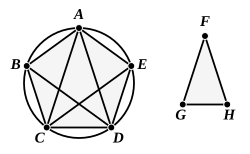

When this is done, we have only to draw a circle with centre $A$ and radius $AB$ and place in it a chord $BD$ equal in length to $AC$. [IV. 1]

Since each of the angles $ABD$, $ADB$ is double of the angle $BAD$, the latter is equal to one-fifth of the sum of all three, i.e. is one-fifth of two right angles, or two-fifths of a right angle, and each of the base angles is four-fifths of a right angle.

If we bisect the angle $BAD$, we obtain an angle equal to one-fifth of a right angle, so that the proposition enables us *to divide a right angle into five equal parts*.

It will be observed that $BD$ is the side of a regular *decagon* inscribed in the larger circle.

Proclus, as remarked above (Vol. I. p. 130), gives IV. 10 as an instance in which two of the six formal divisions of a proposition, the *setting-out* and the "*definition*," are left out, and explains that they are unnecessary because there is no *datum* in the enunciation. This is however no more than formally true, because Euclid does begin his proposition by *setting out* "any straight line $AB$," and he constructs an isosceles triangle having $AB$ for one of its equal sides, i.e. he does practically imply a datum in the enunciation, and a corresponding *setting-out* and "*definition*" in the proposition itself.

---

## PROPOSITION 11.

*In a given circle to inscribe an equilateral and equiangular pentagon.*

Let $ABCDE$ be the given circle;
thus it is required to inscribe in the circle $ABCDE$ an equilateral and equiangular pentagon.

Let the isosceles triangle $FGH$ be set out having each of the angles at $G, H$ double of the angle at $F$; [IV. 10]

let there be inscribed in the circle $ABCDE$ the triangle $ACD$ equiangular with the triangle $FGH$, so that the angle $CAD$ is equal to the angle at $F$ and the angles at $G, H$ respectively equal to the angles $ACD, CDA$; [IV. 2]
therefore each of the angles $ACD, CDA$ is also double of the angle $CAD$.

Now let the angles $ACD, CDA$ be bisected respectively by the straight lines $CE, DB$ [I. 9], and let $AB, BC, DE, EA$ be joined.

Then, since each of the angles $ACD, CDA$ is double of the angle $CAD$,
and they have been bisected by the straight lines $CE, DB$,
