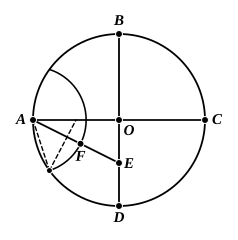

Mr H. M. Taylor gives "a complete geometrical construction for inscribing a regular decagon or pentagon in a given circle," as follows.

"Find $O$ the centre.

Draw two diameters $AOC$, $BOD$ at right angles to one another.

Bisect $OD$ in $E$.

Draw $AE$ and cut off $EF$ equal to $OE$.

Place round the circle ten chords equal to $AF$.

These chords will be the sides of a regular decagon. Draw the chords joining five alternate vertices of the decagon; they will be the sides of a regular pentagon."

The construction is of course only a combination of those in II. 11 and IV. 1; and the proof would have to follow that in IV. 10.

---

## PROPOSITION 12.

*About a given circle to circumscribe an equilateral and equiangular pentagon.*

Let $ABCDE$ be the given circle;
thus it is required to circumscribe an equilateral and equiangular pentagon about the circle $ABCDE$.

Let $A$, $B$, $C$, $D$, $E$ be conceived to be the angular points of the inscribed pentagon, so that the circumferences $AB$, $BC$, $CD$, $DE$, $EA$ are equal; [IV. 11]

through $A$, $B$, $C$, $D$, $E$ let $GH$, $HK$, $KL$, $LM$, $MG$ be drawn touching the circle; [III. 16, Por.]
let the centre $F$ of the circle $ABCDE$ be taken [III. 1], and let $FB$, $FK$, $FC$, $FL$, $FD$ be joined.

Then, since the straight line $KL$ touches the circle $ABCDE$ at $C$,
and $FC$ has been joined from the centre $F$ to the point of contact at $C$,
therefore $FC$ is perpendicular to $KL$; [III. 18]
therefore each of the angles at $C$ is right.

For the same reason
the angles at the points $B$, $D$ are also right.
