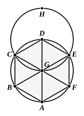

Now, since the angle $BCD$ is equal to the angle $CDE$,
and the angle $FCD$ is half of the angle $BCD$,
and the angle $CDF$ half of the angle $CDE$,
therefore the angle $FCD$ is also equal to the angle $CDF$,
so that the side $FC$ is also equal to the side $FD$. [I. 6]

Similarly it can be proved that
each of the straight lines $FB$, $FA$, $FE$ is also equal to each of the straight lines $FC$, $FD$;
therefore the five straight lines $FA$, $FB$, $FC$, $FD$, $FE$ are equal to one another.

Therefore the circle described with centre $F$ and distance one of the straight lines $FA$, $FB$, $FC$, $FD$, $FE$ will pass also through the remaining points, and will have been circumscribed.

Let it be circumscribed, and let it be $ABCDE$.

Therefore about the given pentagon, which is equilateral 
and equiangular, a circle has been circumscribed.Q. E. F.

---

## PROPOSITION 15.

In a given circle to inscribe an equilateral and equiangular 
hexagon.

Let $ABCDEF$ be the given circle;
thus it is required to inscribe an equilateral and equiangular hexagon in the circle $ABCDEF$.

Let the diameter $AD$ of the circle $ABCDEF$ be drawn;
let the centre $G$ of the circle be taken, and with centre $D$ and distance $DG$ let the circle $EGCH$ be described;
let $EG$, $CG$ be joined and carried through to the points $B$, $F$,
and let $AB$, $BC$, $CD$, $DE$, $EF$, $FA$ be joined.

I say that the hexagon ">$ABCDEF$ is equilateral and equiangular.

For, since the point $G$ is the centre of the circle $ABCDEF$,
$GE$ is equal to $GD$.
