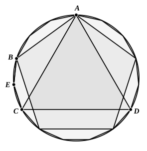

### PROPOSITION 16.

In a given circle to inscribe a fifteen-angled figure which 
shall be both equilateral and equiangular.

Let $ABCD$ be the given circle;
thus it is required to inscribe in the circle $ABCD$ a fifteen-angled figure which shall be both equilateral and equiangular.

In the circle $ABCD$ let there be inscribed a side $AC$ of the equilateral triangle inscribed in it, and a side $AB$ of an equilateral pentagon;
therefore, of the equal segments of which there are fifteen in the circle $ABCD$, there will be five in the circumference $ABC$ which is one-third of the circle, and there will be three in the circumference $AB$ which is one-fifth of the circle;

therefore in the remainder $BC$ there will be two of the equal segments.

Let $BC$ be bisected at $E$; [III. 30]
therefore each of the circumferences $BE$, $EC$ is a fifteenth of the circle $ABCD$.

If therefore we join $BE$, $EC$ and fit into the circle $ABCD$ straight lines equal to them and in contiguity, a fifteen-angled figure which is both equilateral and equiangular will have been inscribed in it.

And, in like manner as in the case of the pentagon, if
through the points of division on the circle we draw
tangents to the circle, there will be circumscribed about the
circle a fifteen-angled figure which is equilateral and equi-
angular.

And further, by proofs similar to those in the case of the
pentagon, we can both inscribe a circle in the given fifteen-
angled figure and circumscribe one about it.
