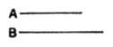

# BOOK IX.

### PROPOSITION 1.

*If two similar plane numbers by multiplying one another make some number, the product will be square.*

Let *A*, *B* be two similar plane numbers, and let *A* by multiplying *B* make *C*;  
I say that *C* is square.

For let *A* by multiplying itself make *D*.  
Therefore *D* is square.

Since then *A* by multiplying itself has made *D*, and by multiplying *B* has made *C*, therefore, as *A* is to *B*, so is *D* to *C*. [VII. 17]

And, since *A*, *B* are similar plane numbers, therefore one mean proportional number falls between *A*, *B*. [VIII. 18]

But, if numbers fall between two numbers in continued proportion, as many as fall between them, so many also fall between those which have the same ratio; [VIII. 8] so that one mean proportional number falls between *D*, *C* also.

And *D* is square;  
therefore *C* is also square. [VIII. 22]

**Q. E. D.**

---

The product of two similar plane numbers is a square.  
Let $a$, $b$ be two similar plane numbers.  
Now
$$a : b = a^2 : ab. \hfill \text{[VII. 17]}$$
And between $a$, $b$ there is one mean proportional. [VIII. 18]  
Therefore between $a^2 : ab$ there is one mean proportional. [VIII. 8]  
And $a^2$ is square;  
therefore $ab$ is square. [VIII. 22]
