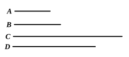

### PROPOSITION 2.

*If two numbers by multiplying one another make a square number, they are similar plane numbers.*

Let *A*, *B* be two numbers, and let *A* by multiplying *B* make the square number *C*;  
I say that *A*, *B* are similar plane numbers.

For let *A* by multiplying itself make *D*;  
therefore *D* is square.

Now, since *A* by multiplying itself has made *D*, and by multiplying *B* has made *C*, therefore, as *A* is to *B*, so is *D* to *C*. [VII. 17]

And, since *D* is square, and *C* is so also, therefore *D*, *C* are similar plane numbers.

Therefore one mean proportional number falls between *D*, *C*. [VIII. 18]

And, as *D* is to *C*, so is *A* to *B*; therefore one mean proportional number falls between *A*, *B* also. [VIII. 8]

But, if one mean proportional number fall between two numbers, they are similar plane numbers; [VIII. 20]  
therefore *A*, *B* are similar plane numbers.

**Q. E. D.**

---

If $ab$ is a square number, $a$, $b$ are similar plane numbers. (The converse of IX. 1.)  
For
$$a : b = a^2 : ab. \hfill \text{[VII. 17]}$$
And $a^2$, $ab$ being square numbers, and therefore similar plane numbers, they have one mean proportional. [VIII. 18]  
Therefore $a$, $b$ also have one mean proportional. [VIII. 8]  
whence $a$, $b$ are similar plane numbers. [VIII. 20]

---

### PROPOSITION 3.

*If a cube number by multiplying itself make some number, the product will be cube.*

For let the cube number *A* by multiplying itself make *B*;  
I say that *B* is cube.
