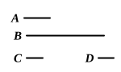

For let *C*, the side of *A*, be taken, and let *C* by multiplying itself make *D*.

It is then manifest that *C* by multiplying *D* has made *A*.

Now, since *C* by multiplying itself has made *D*, therefore *C* measures *D* according to the units in itself.

But further the unit also measures *C* according to the units in it; therefore, as the unit is to *C*, so is *C* to *D*. [VII. Def. 20]

Again, since *C* by multiplying *D* has made *A*, therefore *D* measures *A* according to the units in *C*.

But the unit also measures *C* according to the units in it; therefore, as the unit is to *C*, so is *D* to *A*.

But, as the unit is to *C*, so is *C* to *D*; therefore also, as the unit is to *C*, so is *C* to *D*, and *D* to *A*.

Therefore between the unit and the number *A* two mean proportional numbers *C*, *D* have fallen in continued proportion.

Again, since *A* by multiplying itself has made *B*, therefore *A* measures *B* according to the units in itself.

But the unit also measures *A* according to the units in it; therefore, as the unit is to *A*, so is *A* to *B*. [VII. Def. 20]

But between the unit and *A* two mean proportional numbers have fallen; therefore two mean proportional numbers will also fall between *A*, *B*. [VIII. 8]

But, if two mean proportional numbers fall between two numbers, and the first be cube, the second will also be cube. [VIII. 23]

And *A* is cube;  
therefore *B* is also cube.

**Q. E. D.**

---

The product of $a^3$ into itself, or $a^3 \cdot a^3$, is a cube.  
For
$$1 : a = a : a^2 = a^2 : a^3.$$
Therefore between $1$ and $a^3$ there are two mean proportionals.  
Also
$$1 : a^3 = a^3 : a^3 \cdot a^3.$$
Therefore two mean proportionals fall between $a^3$ and $a^3 \cdot a^3$. [VIII. 8]  
(It is true that VIII. 8 is only enunciated of two pairs of numbers, but the proof is equally valid if one number of one pair is unity.)  
And $a^3$ is a cube number:  
therefore $a^3 \cdot a^3$ is also cube. [VIII. 23]
