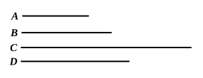

### PROPOSITION 4.

*If a cube number by multiplying a cube number make some number, the product will be cube.*

For let the cube number $A$ by multiplying the cube number $B$ make $C$;  
I say that $C$ is cube.

For let $A$ by multiplying itself make $D$;  
therefore $D$ is cube. [IX. 3]

And, since $A$ by multiplying itself has made $D$, and by multiplying $B$ has made $C$, therefore, as $A$ is to $B$, so is $D$ to $C$. [VII. 17]

And, since $A$, $B$ are cube numbers, $A$, $B$ are similar solid numbers.

Therefore two mean proportional numbers fall between $A$, $B$; [VIII. 19]  
so that two mean proportional numbers will fall between $D$, $C$ also. [VIII. 8]

And $D$ is cube;  
therefore $C$ is also cube. [VIII. 23]

**Q. E. D.**

---

The product of two cubes, say $a^3 \cdot b^3$, is a cube.  
For
$$a^3 : b^3 = a^3 \cdot a^3 : a^3 \cdot b^3. \hfill \text{[VII. 17]}$$
And two mean proportionals fall between $a^3$, $b^3$ which are similar solid numbers. [VIII. 19]  
Therefore two mean proportionals fall between $a^3 \cdot a^3$, $a^3 \cdot b^3$. [VIII. 8]  
But $a^3 \cdot a^3$ is a cube: [IX. 3]  
therefore $a^3 \cdot b^3$ is a cube. [VIII. 23]

---

### PROPOSITION 5.

*If a cube number by multiplying any number make a cube number, the multiplied number will also be cube.*

For let the cube number $A$ by multiplying any number $B$ make the cube number $C$;  
I say that $B$ is cube.

For let $A$ by multiplying itself make $D$;  
therefore $D$ is cube. [IX. 3]
