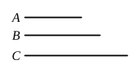

Now, since $A$ by multiplying itself has made $D$, and by multiplying $B$ has made $C$, therefore, as $A$ is to $B$, so is $D$ to $C$. [VII. 17]

And since $D$, $C$ are cube, they are similar solid numbers.

Therefore two mean proportional numbers fall between $D$, $C$. [VIII. 19]

And, as $D$ is to $C$, so is $A$ to $B$; therefore two mean proportional numbers fall between $A$, $B$ also. [VIII. 8]

And $A$ is cube;  
therefore $B$ is also cube. [VIII. 23]

---

If the product $a^3b$ is a cube number, $b$ is cube.  
By IX. 3, the product $a^3 \cdot a^3$ is a cube.  
And
$$a^3 \cdot a^3 : a^3b = a^3 : b. \hfill \text{[VII. 17]}$$
The first two terms are cubes, and therefore "similar solids"; therefore there are two mean proportionals between them. [VIII. 19]  
Therefore there are two mean proportionals between $a^3$, $b$. [VIII. 8]  
And $a^3$ is a cube:  
therefore $b$ is a cube number. [VIII. 23]

---

### PROPOSITION 6.

*If a number by multiplying itself make a cube number, it will itself also be cube.*

For let the number $A$ by multiplying itself make the cube number $B$;  
I say that $A$ is also cube.

For let $A$ by multiplying $B$ make $C$.

Since, then, $A$ by multiplying itself has made $B$, and by multiplying $B$ has made $C$, therefore $C$ is cube.

And, since $A$ by multiplying itself has made $B$, therefore $A$ measures $B$ according to the units in itself.

But the unit also measures $A$ according to the units in it.  
Therefore, as the unit is to $A$, so is $A$ to $B$. [VII. Def. 20]

And, since $A$ by multiplying $B$ has made $C$, therefore $B$ measures $C$ according to the units in $A$.

But the unit also measures $A$ according to the units in it.
