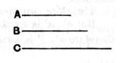

Now, since *A* by multiplying itself has made *D*, and by multiplying *B* has made *C*, therefore, as *A* is to *B*, so is *D* to *C*. [VII. 17]

And since *D*, *C* are cube, they are similar solid numbers.

Therefore two mean proportional numbers fall between *D*, *C*. [VIII. 19]

And, as *D* is to *C*, so is *A* to *B*; therefore two mean proportional numbers fall between *A*, *B* also. [VIII. 8]

And *A* is cube;  
therefore *B* is also cube. [VIII. 23]

---

If the product $a^3b$ is a cube number, $b$ is cube.  
By IX. 3, the product $a^3 \cdot a^3$ is a cube.  
And
$$a^3 \cdot a^3 : a^3b = a^3 : b. \hfill \text{[VII. 17]}$$
The first two terms are cubes, and therefore "similar solids"; therefore there are two mean proportionals between them. [VIII. 19]  
Therefore there are two mean proportionals between $a^3$, $b$. [VIII. 8]  
And $a^3$ is a cube:  
therefore $b$ is a cube number. [VIII. 23]

---

### PROPOSITION 6.

*If a number by multiplying itself make a cube number, it will itself also be cube.*

For let the number *A* by multiplying itself make the cube number *B*;  
I say that *A* is also cube.

For let *A* by multiplying *B* make *C*.

Since, then, *A* by multiplying itself has made *B*, and by multiplying *B* has made *C*, therefore *C* is cube.

And, since *A* by multiplying itself has made *B*, therefore *A* measures *B* according to the units in itself.

But the unit also measures *A* according to the units in it.  
Therefore, as the unit is to *A*, so is *A* to *B*. [VII. Def. 20]

And, since *A* by multiplying *B* has made *C*, therefore *B* measures *C* according to the units in *A*.

But the unit also measures *A* according to the units in it.
