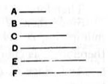

Similarly $a_9, a_{12}, \dots$ are cubes.  
Clearly then $a_6, a_{12}, a_{18}, \dots$ are both squares and cubes.  
The whole result is of course obvious if the geometrical progression is written, with our notation, as
$$1, a, a^2, a^3, a^4, \dots a^n.$$

---

### PROPOSITION 9.

*If as many numbers as we please beginning from an unit be in continued proportion, and the number after the unit be square, all the rest will also be square. And, if the number after the unit be cube, all the rest will also be cube.*

Let there be as many numbers as we please, $A, B, C, D, E, F,$ beginning from an unit and in continued proportion, and let $A,$ the number after the unit, be square;  
I say that all the rest will also be square.

Now it has been proved that $B,$ the third from the unit, is square, as are also all those which leave out one; [ix. 8]  
I say that all the rest are also square.

For, since $A, B, C$ are in continued proportion, and $A$ is square,  
therefore $C$ is also square. [VIII. 22]

Again, since $B, C, D$ are in continued proportion, and $B$ is square,  
$D$ is also square. [VIII. 22]

Similarly we can prove that all the rest are also square.

Next, let $A$ be cube;  
I say that all the rest are also cube.

Now it has been proved that $C,$ the fourth from the unit, is cube, as also are all those which leave out two; [ix. 8]  
I say that all the rest are also cube.

For, since as the unit is to $A,$ so is $A$ to $B,$  
therefore the unit measures $A$ the same number of times as $A$ measures $B.$

But the unit measures $A$ according to the units in it;  
therefore $A$ also measures $B$ according to the units in itself;  
therefore $A$ by multiplying itself has made $B.$
