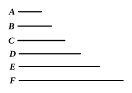

I say that neither will any other be square except the third 
from the unit <and those which 
leave out one>.

For, if possible, let $C$ be square.

But $B$ is also square ; [ix. 8]

[therefore $B$, $C$ have to one another 
the ratio which a square number 
has to a square number].

And, as $B$ is to $C$, so is $A$ to $B$ ;

therefore $A$, $B$ have to one another the ratio which a square 
number has to a square number ;

[so that $A$, $B$ are similar plane numbers]. [VIII. 26, converse]

And $B$ is square ;

therefore $A$ is also square : 
which is contrary to the hypothesis.

Therefore $C$ is not square.

Similarly we can prove that neither is any other of the 
numbers square except the third from the unit and those which 
leave out one.

Next, let $A$ not be cube ; 
I say that neither will any other be cube except the fourth 
from the unit and those which leave out two.

For, if possible, let $D$ be cube.

Now $C$ is also cube ; for it is fourth from the unit. [ix. 8]

And, as $C$ is to $D$, so is $B$ to $C$ ;

therefore $B$ also has to $C$ the ratio which a cube has to a cube.

And $C$ is cube ;

therefore $B$ is also cube. [VIII. 25]

And since, as the unit is to $A$, so is $A$ to $B$, 
and the unit measures $A$ according to the units in it,

therefore $A$ also measures $B$ according to the units in itself ;

therefore $A$ by multiplying itself has made the cube number $B$.

But, if a number by multiplying itself make a cube number, 
it is also itself cube. [ix. 6]

Therefore $A$ is also cube : 
which is contrary to the hypothesis.

Therefore $D$ is not cube.

