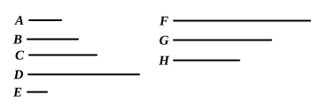

### PROPOSITION 12.

*If as many numbers as we please beginning from an unit be in continued proportion, by however many prime numbers the last is measured, the next to the unit will also be measured by the same.*

Let there be as many numbers as we please, $A$, $B$, $C$, $D$, beginning from an unit, and in continued proportion;  
I say that, by however many prime numbers $D$ is measured, $A$ will also be measured by the same.

For let $D$ be measured by any prime number $E$;  
I say that $E$ measures $A$.

For suppose it does not;  
now $E$ is prime, and any prime number is prime to any which it does not measure; [VII. 29]  
therefore $E$, $A$ are prime to one another.

And, since $E$ measures $D$, let it measure it according to $F$,  
therefore $E$ by multiplying $F$ has made $D$.

Again, since $A$ measures $D$ according to the units in $C$, [ix. 11 and Por.]  
therefore $A$ by multiplying $C$ has made $D$.

But, further, $E$ has also by multiplying $F$ made $D$;  
therefore the product of $A$, $C$ is equal to the product of $E$, $F$.

Therefore, as $A$ is to $E$, so is $F$ to $C$. [VII. 19]

But $A$, $E$ are prime,  
primes are also least, [VII. 21]  
and the least measure those which have the same ratio the same number of times, the antecedent the antecedent and the consequent the consequent; [VII. 20]  
therefore $E$ measures $C$.

Let it measure it according to $G$;  
therefore $E$ by multiplying $G$ has made $C$.

But, further, by the theorem before this,  
$A$ has also by multiplying $B$ made $C$. [ix. 11 and Por.]
